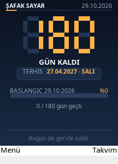
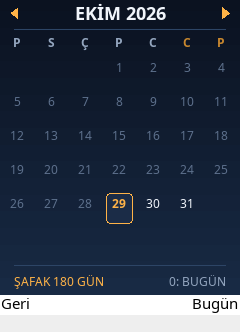
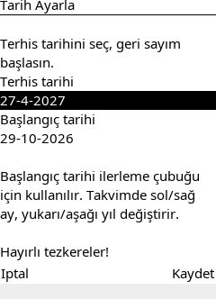
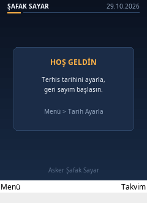
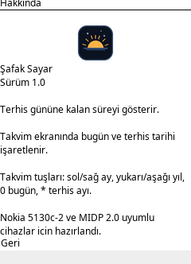

# Şafak Sayar

A small Turkish "şafak / terhis" countdown and calendar MIDlet for the
**Nokia 5130c-2** (MIDP 2.0, CLDC 1.1).

The phone runs Java ME `.jar` applications. This project builds a
preverified MIDlet JAR plus the matching JAD file:

```
dist/SafakSayar.jar
dist/SafakSayar.jad
dist/SafakSayar.zip   (both files in one archive)
```

## What it does

- Big seven-segment countdown to the discharge ("terhis") day.
- Shows the discharge date, day name and a progress bar from the service
  start date.
- Monthly calendar where **today** is outlined and the **discharge day** is
  filled in amber.
- Counts "days left" before discharge, shows `TERHİS GÜNÜ!` on the day, and
  "days since" afterwards.
- Saves both dates in a MIDP `RecordStore`, so the countdown survives
  restarts.
- Daily short motivational line in Turkish.

<p align="center">
  
  
</p>

<p align="center">
  
  
  
</p>


### Keys

| Screen | Keys |
| --- | --- |
| Countdown | `Takvim` / `Menü` softkeys, center key opens calendar |
| Calendar | left/right = month, up/down = year, `0` = today, `*` = discharge month |
| Menu | `Tarih Ayarla`, `Takvim`, `Hakkında`, `Çıkış` |

## Install on the Nokia 5130c-2

1. Connect the phone by USB (mass storage) or Bluetooth.
2. Copy **both** `SafakSayar.jar` and `SafakSayar.jad` into the same folder
   on the phone or memory card. (You can also copy `SafakSayar.zip` and
   extract it there.)
3. On the phone, open the `.jad` file (or the `.jar` if your file manager
   only shows that). Accept the installation.
4. The app appears in **Menu → Applications** (or **Collection**).
5. On first launch, set:
   - **Terhis tarihi** — the actual discharge date.
   - **Başlangıç tarihi** — the start of the service; used only for the
     progress bar.

The first-run default is 180 days from today, so change it to the real
date before saving.

The JAR is compiled to Java 1.4 bytecode (class file version 48) and
preverified with CLDC `StackMap` attributes, which is what the S40 phone
expects. It uses only standard MIDP 2.0 / CLDC 1.1 APIs.

## Build from source

Requirements: Linux/macOS shell, `curl`, `tar`, and network access the first
time. A JDK 8 is required to emit Java 1.4 bytecode; if it is not installed,
`build.sh` downloads Temurin 8 into `.tools/jdk8` (about 100 MB).

```sh
./build.sh          # build dist/SafakSayar.jar + .jad
./build.sh test     # run the date tests, then build
```

If you already have a JDK 8:

```sh
JAVA8_HOME=/path/to/jdk8 ./build.sh test
```

The build also downloads ProGuard 6.3 once into `.tools/` and uses the API
stub JARs in `lib/` for compiling and preverification.

### Project layout

```
src/com/safaksayar/
  SafakSayarMIDlet.java   MIDlet, screen switching, menu
  CountdownCanvas.java    main countdown screen
  CalendarCanvas.java     month calendar
  SettingsForm.java       date pickers
  AboutForm.java          about/help
  DateUtil.java           timezone-safe civil date math
  Store.java              RecordStore persistence
  SevenSegment.java       big digit renderer
  Ui.java                 colors and drawing helpers
res/icon.png              48x48 app icon
res/MANIFEST.MF           MIDlet manifest
test/DateUtilTest.java    date-math tests (1970–2100 vs java.time)
```

### Customizing

- Colors: `src/com/safaksayar/Ui.java`.
- Daily quotes: `QUOTES` in `CountdownCanvas.java`.
- First-run default date: `DateUtil.today() + 180` in `SettingsForm.java`.
- App name/vendor: `res/MANIFEST.MF` and `build.sh` (JAD).

## Notes

- The UI strings are Turkish; Turkish characters are stored in the class
  files as modified UTF-8 and render on S40 phones.
- No Nokia proprietary APIs are used, so the same JAR also runs on other
  MIDP 2.0 / CLDC 1.1 phones with a 240×320 screen.
- The layout adapts to the available canvas height and width.

Hayırlı tezkereler!
